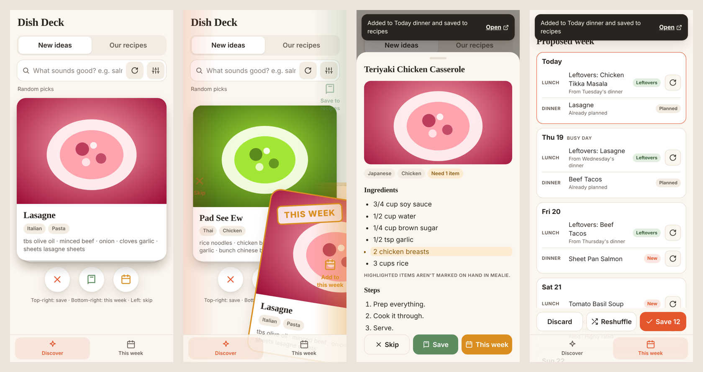

# Dish Deck

**Swipe through meal ideas, cook with what's on hand, plan the week in [Mealie](https://mealie.io), and when nobody wants to cook, find somewhere to eat today.**

Dish Deck is a small, mobile-first web app you install on your phone (it's a PWA). It sits in front of your self-hosted Mealie server: everything you save goes straight into Mealie, and Dish Deck keeps no database of its own.


<sub>Screens from the development mock server, which uses placeholder food images.</sub>

## Features

- **Swipe deck**
  - Drag a card **top-right** to save it to Mealie, **bottom-right** to save it *and* put it on a day's lunch or dinner, **left** to skip. Tap a card for ingredients and steps.
  - **Real recipes from trusted sites**: pick a cuisine (or, with AI on, type a craving) and the cards are real recipes from well-regarded sites for that cuisine, e.g. The Woks of Life and Red House Spice for Chinese, Korean Bapsang for Korean, Pati Jinich for Mexican. Each card shows the site and links back to it. See [Where recipes come from](#where-recipes-come-from).
  - **Authentic by default**: with AI on, Claude picks the dishes: home-style cooking from each cuisine's regions (rotating, e.g. Sichuan and Dongbei one deal, Cantonese and Yunnan the next), with the dish's native name. It only names dishes, which keeps token use small; the recipes come from the sites. The **Style** filter switches to *Weeknight shortcuts* or *Takeout favorites*.
  - **AI is optional.** With it off, everything still comes from the trusted sites, free: a cuisine browses that cuisine's sites, a typed search looks through the sites' indexes ("salmon", "dumplings", "noodle soup"), and plain browsing draws from every site. [TheMealDB](https://www.themealdb.com) is the backup, and handles the *Type* filter (Beef, Pasta, …). Flipping the **AI** switch keeps your filters and the card you're looking at.
  - **Every card has a real photo**: the recipe site's own, or one from Wikipedia (or Pexels if you add a key); cards with no photo are skipped.
  - **Skips are remembered** for the whole household, on every phone and across restarts, so a skipped recipe doesn't come back.
  - Tap a card and drag its sheet down (or tap the backdrop) to close it.
  - **Our recipes** is your recipe book: every saved Mealie recipe in one grid of cards (see below).
- **"What sounds good?"**: type a mood ("cozy soup", "something with salmon") or pick a cuisine or dish type.
- **Recipe book**: "Our recipes" shows every saved Mealie recipe at once as a grid of cards. Search by name or ingredient, filter by meal, dietary needs, nutrition, category/tag or "have everything on hand", and sort by name, newest or oldest saved, quickest, rating or fewest missing ingredients. Tap a card to see it or add it to this week.
- **Filters** (pick as many as you like; within a filter, picks mean "any of these", e.g. lunch or dinner): meal (breakfast, lunch, dinner, dessert, snack), dietary restrictions and allergies (vegetarian, vegan, pescatarian, gluten-, dairy-, egg-, nut-, shellfish- and soy-free) and nutrition goals (low calorie, low carb, keto, high protein, high fiber, low fat). Dietary filters are the exception: a card must meet all of them, and they check every card's ingredients, whatever the source. Nutrition goals use AI estimates for new ideas (TheMealDB has no nutrition data) and Mealie's nutrition fields or tags for saved recipes. On *New ideas*, filter changes apply when you close the filter panel (or tap **Apply filters**). Long lists like cuisine show the most common options first, with **+N more** for the rest.
- **Use what's on hand**: only show dishes you can mostly make with the foods marked *on hand* in Mealie, allowing up to *N* missing ingredients. For saved recipes it uses Mealie's own recipe finder.
- **Randomize this week**: fills open lunch and dinner slots for the next 7 days from your saved recipes, then lets you reroll any slot before saving. It's rules-based, so it's free and predictable:
  - dinners that make leftovers become the next day's lunch
  - recently eaten meals are avoided
  - proteins rotate, and proteins you have on hand get a boost
  - busy days get quick dinners
- **Eat out** (optional tab, needs a Google Maps key): find somewhere to eat today. See [Eat out](#eat-out).
- Light and dark mode, works offline for the app shell, optional household passcode.

## How it fits together

```
 phone (PWA) ──► Dish Deck server ──► Mealie API        (recipes, meal plans, on-hand foods)
                       │          ├──► recipe sites      (sitemaps + recipe pages, free)
                       │          ├──► TheMealDB API     (free recipe ideas)
                       │          ├──► Claude API        (optional: dish names, AI recipes)
                       │          ├──► Wikipedia/Pexels  (photos when a recipe has none)
                       │          ├──► Google Places     (optional: Eat out tab)
                       │          └──► SearXNG           (optional free search fallback, local restaurant chatter)
                       └── /data: SQLite cache + household history
```

The browser only ever talks to the Dish Deck server. Your Mealie token and AI key stay on the server.

## What you need

- A running **Mealie** server, v3.x. The API calls were checked against Mealie v3.31.0.
- Somewhere to run a container: Docker, Docker Compose or Kubernetes. Or Node.js 22+ directly.
- **HTTPS** if you want to install it on phones. Browsers only allow installing web apps over HTTPS; see [Exposing it](#exposing-it-and-keeping-it-safe).

## Keys and secrets

All configuration lives in a single **`.env`** file. Copy [`example.env`](example.env) to `.env` and fill it in. `.env` is git-ignored and excluded from Docker builds, so secrets never end up in the repo or the image.

| Variable | Required? | Secret? | What it's for | Where to get it |
|---|---|---|---|---|
| `MEALIE_URL` | **Yes** | No | How the server reaches Mealie | Your Mealie address, e.g. `http://mealie:9000` |
| `MEALIE_TOKEN` | **Yes** | **Yes** | Read recipes and foods, create recipes and meal plans | Mealie → your profile → **API Tokens** → Create. Recipes and plans are created as this user, in their household. |
| `APP_PASSCODE` | Strongly recommended | **Yes** | Shared passcode each device enters once | Make one up, or run `openssl rand -base64 12` |
| `ANTHROPIC_API_KEY` | Optional | **Yes** | AI recipe ideas when you type a craving | [console.anthropic.com](https://console.anthropic.com) → Settings → API Keys. Pay-as-you-go billing must be set up. |
| `GOOGLE_MAPS_API_KEY` | Optional | **Yes** | Turns on the Eat out tab (Places API (New)) | Google Cloud console → APIs & Services → Credentials. See [Eat out](#eat-out). |
| `GOOGLE_MAPS_BROWSER_KEY` | Optional | Restrict it (it reaches the browser) | Map view on the Eat out tab (Maps JavaScript API) | Same place; restrict to your site's address |
| `MEALDB_API_KEY` | Optional | Treat as secret if premium | TheMealDB access | Default `1` is the free test key (personal/development use). A premium key comes with supporting TheMealDB: [themealdb.com/api.php](https://www.themealdb.com/api.php) |

Everything else is a plain setting with a sensible default (see [Configuration](#configuration)).

## Quick start (Docker Compose)

```bash
git clone https://github.com/maclogan/dish-deck.git
cd dish-deck
cp example.env .env
# edit .env: set MEALIE_URL, MEALIE_TOKEN, APP_PASSCODE, TZ (and optionally ANTHROPIC_API_KEY)
docker compose up -d
```

Open `http://<your-server>:8080` and enter your passcode.

**If Mealie also runs in Docker Compose,** the containers need a shared network so `MEALIE_URL=http://mealie:9000` resolves. Either add the `dish-deck` service to Mealie's compose file, or attach it to Mealie's network:

```yaml
# docker-compose.override.yml
services:
  dish-deck:
    networks: [mealie]
networks:
  mealie:
    external: true
    name: mealie_default   # check with: docker network ls
```

**Image:** `docker-compose.yml` pulls `ghcr.io/maclogan/dish-deck:latest`, which GitHub Actions publishes for amd64 and arm64. To build from source instead, replace `image:` with `build: .`.

## Other ways to run it

### Plain Docker

```bash
docker run -d --name dish-deck --env-file .env -p 8080:8080 --restart unless-stopped ghcr.io/maclogan/dish-deck:latest
```

### Kubernetes (MicroK8s, k3s, …)

Your `.env` becomes a Secret, and the Deployment loads every variable from it:

```bash
kubectl create namespace dish-deck
kubectl -n dish-deck create secret generic dish-deck-env --from-env-file=.env
kubectl apply -f deploy/kubernetes.yaml
kubectl -n dish-deck get pods -w
```

- In `.env`, use Mealie's in-cluster address, e.g. `MEALIE_URL=http://mealie.mealie.svc.cluster.local:9000` (service `mealie` in namespace `mealie`).
- **Storage:** the manifest includes a small volume (`dish-deck-data`, 1 GiB) for the recipe cache and the household's skip history. On MicroK8s, make sure storage is enabled: `microk8s enable hostpath-storage`.
- **Update to the newest version** (after GitHub Actions finishes building `main`). The old pod stops before the new one starts, since only one pod can own the data volume; expect a few seconds of downtime.
  ```bash
  kubectl -n dish-deck rollout restart deploy/dish-deck
  kubectl -n dish-deck rollout status deploy/dish-deck
  ```
- **Automatic updates (optional):** install [Keel](https://keel.sh) once, and every new `:latest` image rolls out within about a minute of being published. The manifest already carries Keel's annotations, so no other changes are needed.
  ```bash
  helm repo add keel https://charts.keel.sh && helm repo update
  helm upgrade --install keel keel/keel --namespace keel --create-namespace --set helmProvider.enabled=false
  ```
  (On MicroK8s use `microk8s helm`.) The GHCR package must be public, or Keel needs registry credentials.
- After editing `.env`, update the Secret and restart:
  ```bash
  kubectl -n dish-deck create secret generic dish-deck-env --from-env-file=.env --dry-run=client -o yaml | kubectl apply -f -
  kubectl -n dish-deck rollout restart deploy/dish-deck
  ```
- **Using a locally built image instead of GHCR** (e.g. MicroK8s with no registry):
  ```bash
  docker build -t dish-deck:local .
  docker save dish-deck:local | microk8s images import      # or: | ssh you@server microk8s images import
  ```
  Then set `image: dish-deck:local` and `imagePullPolicy: Never` in `deploy/kubernetes.yaml`. On an Apple Silicon Mac building for an x86 server, add `--platform linux/amd64`.

### Node.js directly

```bash
npm ci
npm run build
cp example.env .env   # fill it in
npm start             # reads ./.env (or set ENV_FILE=/path/to/file)
```

## Configuration

Every setting is documented in [`example.env`](example.env). Variables set in the real environment override the file.

| Variable | Default | Description |
|---|---|---|
| `MEALIE_URL` | (required) | URL the server uses to reach Mealie |
| `MEALIE_TOKEN` | (required) | Mealie API token |
| `APP_PASSCODE` | (none) | Household passcode. If unset, the app is open to anyone who can reach it. |
| `MEALIE_PUBLIC_URL` | (none) | Public Mealie URL, for "Open in Mealie" links |
| `TZ` | system timezone | IANA timezone that decides what "today" is, e.g. `America/Chicago` |
| `ANTHROPIC_API_KEY` | (none) | Turns on AI ideas |
| `ANTHROPIC_MODEL` | `claude-haiku-5-5` | Claude model for AI ideas |
| `HOUSEHOLD_CONTEXT` | `a busy family` | A few words about who you cook for, used in AI prompts |
| `PEXELS_API_KEY` | (none) | Optional free [Pexels](https://www.pexels.com/api/) key: stock food photos when Wikipedia has none |
| `WIKIPEDIA_API_URL` | `https://en.wikipedia.org/w/api.php` | MediaWiki API used for dish photos (rarely changed) |
| `MEALDB_API_KEY` | `1` | TheMealDB key |
| `DATA_DIR` | `/data` in the image | Folder for the SQLite cache and household history. Without a writable folder, both last only until a restart. |
| `RECIPE_SITES` | (none) | Extra trusted sites, tried before the defaults: `Chinese: site.com, other.com; Jamaican: site.com` |
| `SEARXNG_URL` | (none) | Optional self-hosted [SearXNG](https://docs.searxng.org) for dishes the sites' indexes miss |
| `PREFETCH_SECONDS_PER_SITE` | `5` | Background reader: seconds between requests to any one site (`0` turns it off) |
| `BUSY_DAYS` | (none) | Days needing quick dinners, e.g. `tue,thu` |
| `PLAN_START` | `today` | First day of the 7-day plan: `today`, `tomorrow`, `monday`, `sunday` |
| `LEFTOVERS` | `true` | Turn leftover-friendly dinners into next-day lunches |
| `STAPLES` | salt, pepper, water, oils, sugar, flour, butter | Ingredients never counted as missing |
| `GOOGLE_MAPS_API_KEY` | (none) | Eat out tab: Google Places key (server only) |
| `GOOGLE_MAPS_BROWSER_KEY` | (none) | Eat out tab: Map view key (restricted browser key) |
| `PORT` | `8080` | Port to listen on |
| `LOG_LEVEL` | `info` | `fatal`, `error`, `warn`, `info`, `debug` |
| `ENV_FILE` | `.env` | Path of the env file to load (Node only) |

If something is missing or invalid, the server refuses to start and lists every problem at once.

## Exposing it and keeping it safe

Dish Deck can write to your Mealie and spend AI credit, so treat it like Mealie itself:

1. **Set `APP_PASSCODE`.**
2. **Serve it over HTTPS.** Phones need HTTPS to install it. Common options:
   - **Cloudflare Tunnel:** add a public hostname, e.g. `dishes.example.com` → `http://<dish-deck address>:8080`. Then add a Cloudflare Access policy limited to your household's emails.
   - **A reverse proxy** you already run (Caddy, Traefik, nginx, Nginx Proxy Manager) with a certificate.
   - **Tailscale:** reach it privately from your phones with `tailscale serve`.
3. **Optionally put a login in front of it** (Cloudflare Access, Authelia, Authentik). The app works behind them unchanged.

## Install on your phone

Open your Dish Deck URL, then:
- **Android (Chrome):** menu → **Install app** (or **Add to Home screen**)
- **iPhone (Safari):** Share → **Add to Home Screen**

## Getting the most out of it

Dish Deck reads what's already in Mealie, so a little tidying there pays off:

- **Mark foods on hand:** Mealie → Data Management → Foods. This powers "Use what's on hand" and the planner's protein boost.
- **Parse ingredients:** recipes saved from Dish Deck arrive with plain-text ingredients. Open one in Mealie and use the ingredient parser to link foods, so Mealie's recipe finder can match it.
- **Categories and tags the planner understands:**
  - Category **Lunch**, or tags `lunch`, `sandwich`, `salad`, `soup`, `wrap`, `bowl`: lunch options. Other recipes count as dinners, unless they're breakfast, dessert, side, snack or drink.
  - `quick`, `weeknight`, `30 min`, or a total time of 30 minutes or less: picked on busy days.
  - `leftovers`, `freezer friendly`, `meal prep`, or 4+ servings: becomes next-day lunch. `no leftovers` opts out.
  - `go-to`, `favorite`: picked more often.
  - `new to try`: added automatically to recipes saved from Dish Deck, and gets a small boost.
  - `not again`: never picked.
  - Star ratings: higher-rated recipes come up more often.

## Where recipes come from

1. **Claude names the dishes** (AI on). One short request returns about 25 dish names with their native and romanized names, saved per cuisine/style/search and dealt from over many decks. Claude is only asked again when the list runs low (and not at all for a week if it had nothing new to add).
2. **Dish Deck finds each dish on a trusted site.** It indexes each site's sitemap (the public list of its pages) weekly and matches dish names against it, then checks the page's real recipe title.
3. **It reads the recipe from the page's schema.org data**, the same data Google and Mealie's importer read. Pages without it go through Mealie's own scraper.
4. **Not on any site?** With AI on, Claude writes that one recipe and the card is labelled *AI recipe*; with AI off, the dish is skipped. If you run SearXNG (below), it's searched first.
5. **AI off:** a cuisine deals random recipes from that cuisine's sites, a typed search matches words against every site's index, and plain browsing draws from all sites. No AI at all.
6. **Reading ahead:** a background job reads every indexed recipe page once and notes which diets and meals it fits, so filters like *vegetarian* or *dessert* pick from recipes already read instead of reading pages while you wait. Each site gets one request every 5 seconds (`PREFETCH_SECONDS_PER_SITE`), or longer if its robots.txt sets a Crawl-delay; sites are read in parallel (4 requests at a time), so the total is up to about 240 pages a minute while no single site sees more than 12. A site with 1,500 recipes takes about 2 hours; everything takes about a day and a few GB of downloads, once. Pages that robots.txt disallows are never fetched, and a site that answers "too many requests" is left alone for an hour. The log reports progress hourly.

Everything is cached in `DATA_DIR`: site indexes, recipes, dish lists, which page each dish matched, photos, and skips. A recipe page is downloaded once.

**Default sites** live in [`server/src/sources/sites.ts`](server/src/sources/sites.ts) (15 cuisines, plus Serious Eats and Simply Recipes for searches and other cuisines). Add your favorites with `RECIPE_SITES`. A site works if it publishes a sitemap and puts schema.org recipe data on its pages (nearly every recipe blog does); sites that block automated requests are skipped, and the server log says so.

**Free search fallback (optional):** [SearXNG](https://docs.searxng.org) is a self-hosted search engine with no keys or fees.
- Kubernetes: `kubectl -n dish-deck create secret generic searxng --from-literal=secret=$(openssl rand -hex 32)`, then `kubectl apply -f deploy/searxng.yaml`, and set `SEARXNG_URL=http://searxng:8080`.
- Docker Compose: `docker compose --profile search up -d` and set `SEARXNG_URL=http://searxng:8080`.

Recipes stay their authors' work: cards link to the original page, and saved recipes keep that link in Mealie.

## Eat out

The **Eat out** tab helps decide where to eat today and find new places. It appears when `GOOGLE_MAPS_API_KEY` is set.

- **Where and when:** uses the phone's location (or type an address, or pick a saved Home/Work or recent spot; if the phone won't share its location, it starts from Denver, CO) and a time today (now, lunch, dinner or any time). Opening hours are checked for that time.
- **Search for a vibe:** type what you're after ("cozy hole-in-the-wall", "date night", "cheap tacos open late"). With AI on, Claude turns it into a Google search plus filters, then reads each result's reviews and reranks them, with a line on why each one fits. With AI off it's a plain Google search.
- **Filters:** distance (3 miles to start, up to 25), open at the chosen time, rating, price, chain or independent, cuisine, dine-in/takeout/delivery, outdoor seating, groups, kids, vegetarian, takes reservations. Sort by best match, nearest, top rated or **hidden gems** (well loved, not many reviews yet, independent).
- **Each place shows** rating, price, distance, hours, chain or independent, its most important facts as tags, size, and whether you need a reservation, plus links to its **Google listing** and **website**. Open it for photos, directions, phone, an AI summary of reviews, *What locals say* (city subreddit, local blogs and news, via SearXNG), and Google's reviews. How busy a place gets isn't estimated; Google's popular times are on its Google listing.
- **Display:** a List, Deck (one at a time, swipe) or Map view, remembered per phone.
- **Today only:** star places to a shortlist and compare them side by side; swipe a place left to hide it for today. Both clear tomorrow and never affect future searches.
- **Never show again:** the one thing that lasts. It's kept for the whole household (every phone), and the list in the tab lets you bring a place back.

**With AI off** you still get Google's results, filters and details. What you lose: the vibe search becomes a keyword search with no reranking; tags are only Google's yes/no attributes (outdoor seating, takes reservations, …) instead of things like *cash only*, *tiny* or *long waits*; there's no size estimate or review summary; reservation advice uses Google's "takes reservations" flag and price only; local chatter shows as a list of links instead of a summary.

**Chain detection** uses OpenStreetMap's [name-suggestion-index](https://github.com/osmlab/name-suggestion-index) brand list (BSD-3-Clause, bundled in `server/src/dining/chains-data.ts`; refresh it with `scripts/build-chains.ts`), plus names that appear more than once nearby and Google's fast-food category.

### Setting up Google

1. In the [Google Cloud console](https://console.cloud.google.com), create a project, turn on billing, and enable **Places API (New)** (and **Maps JavaScript API** for the Map view).
2. Create an API key, restrict it to Places API (New), and put it in `GOOGLE_MAPS_API_KEY`. This key stays on the server.
3. Optional: create a second key for the Map view, restricted to **HTTP referrers** (your Dish Deck address) and the **Maps JavaScript API**, and put it in `GOOGLE_MAPS_BROWSER_KEY`. This one is sent to browsers, which is why it must be restricted.
4. Recommended: set a **budget alert** and per-day **quotas** on the APIs, so a bug can't run up a bill.

Each search asks Google for 20 places at a time, with your rating, price, cuisine and open-now filters applied by Google, and fetches another page (up to 3 requests, or one per picked cuisine) only while fewer than 20 places are left after the rest of the filters. Each request includes reviews and dine-in/outdoor/reservation details (Google's "Enterprise + Atmosphere" price), so opening a place afterwards costs nothing extra. Photos are fetched through the server and cached by the browser. Dish Deck stores only Google place IDs on disk (the never-again list); Google's content is kept in memory for up to an hour.

## Costs and limits

- **TheMealDB's free key** covers a limited catalog (a few hundred meals); it's now mostly a backup.
- **AI** is used for dish names (a short request, cached and reused across many decks), nutrition goals (Claude writes those recipes, since sites rarely list nutrition), and recipes no site has. Haiku is the cheapest model, and you pay per use on your own key.
- **Recipe sites, photo lookups (Wikipedia, Pexels) and SearXNG** are free.
- **Planner and saved-recipe features** run entirely against Mealie and cost nothing.
- **Eat out:** Google gives a free allowance each month per kind of request (about 1,000 searches, 1,000 photo loads, 10,000 address lookups and map loads at the time of writing; check [Google's pricing](https://developers.google.com/maps/billing-and-pricing/pricing)). A household eating out a few times a week usually stays inside it; past it, each search request costs about 4 cents (most searches need one, a heavily filtered one up to three) and a photo under 1 cent. AI for this tab (search planning, reranking, tags and summaries) costs well under a dollar a month on Haiku.

## Development

```bash
npm install
npm run dev:mock          # fake Mealie + TheMealDB on :9100 (no real data touched)
npm run dev:server:mock   # API server on :8080 using dev/mock.env (includes a fake Google Places for Eat out)
# The mock also fakes Claude, two recipe sites and SearXNG, to try the whole flow offline:
# ANTHROPIC_API_KEY=dev ANTHROPIC_BASE_URL=http://localhost:9100 DEV_SITE_PROXY=http://localhost:9100 DATA_DIR=./data npm run dev:server:mock
npm run dev:web           # UI with hot reload on http://localhost:5173
npm test                  # unit + integration tests
npm run typecheck
```

- **Layout:** `server/src` (Fastify + TypeScript), `web/src` (Preact + Vite), `deploy/` (Kubernetes), `dev/` (mock server).
- **Planner logic:** in `server/src/planner.ts`, a pure function with its own tests.

### Releases

GitHub Actions runs the tests on every push. Container images publish to GHCR: every push to `main` updates `:latest` (and `:main`), and version tags publish fixed versions you can pin:

```bash
git tag v0.2.0 && git push origin v0.2.0   # publishes :0.2.0 and :0.2
```

On a private repo, the GHCR package is private too. Make it public in the package settings, or log in with `docker login ghcr.io` before pulling.

## License

[MIT](LICENSE)
